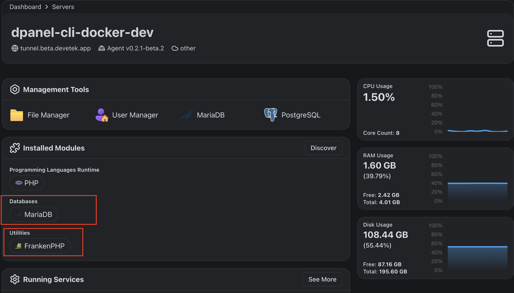
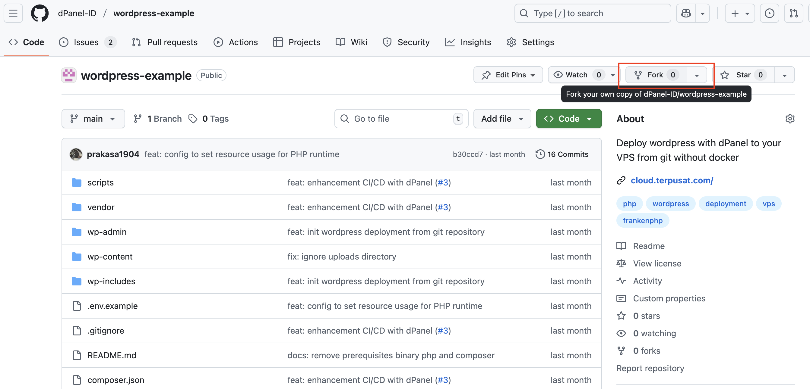
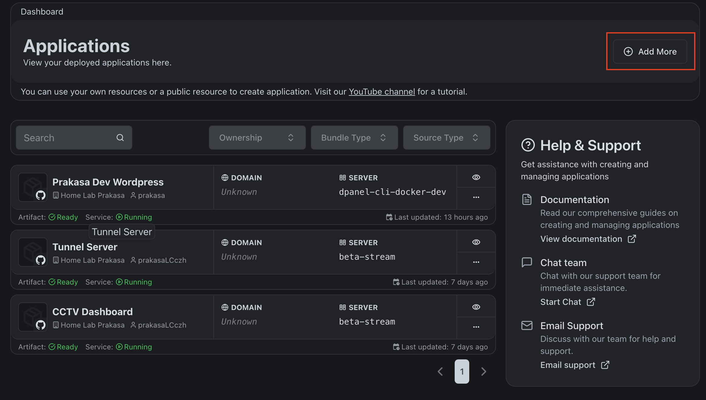
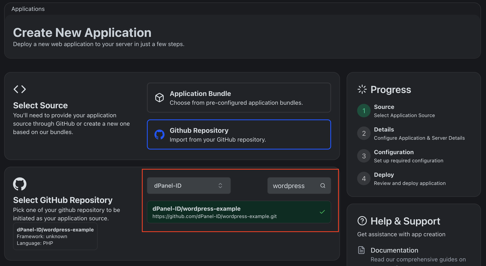
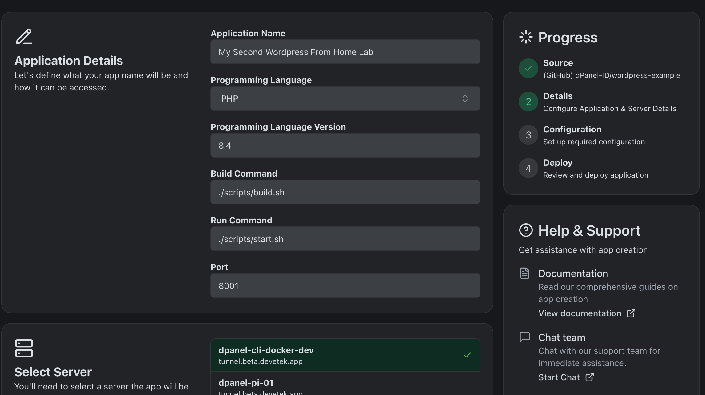
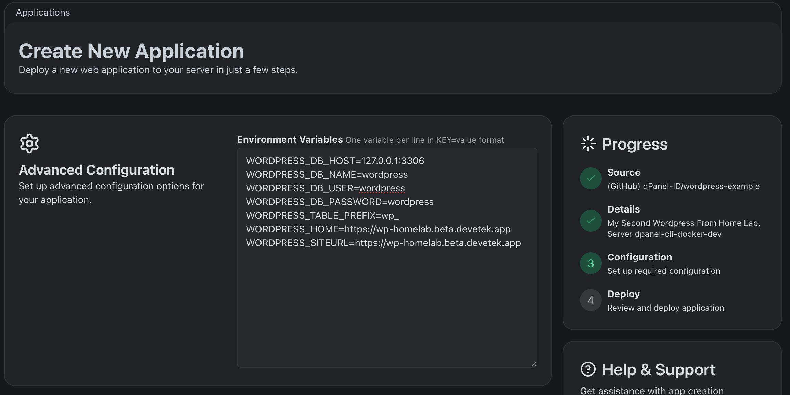
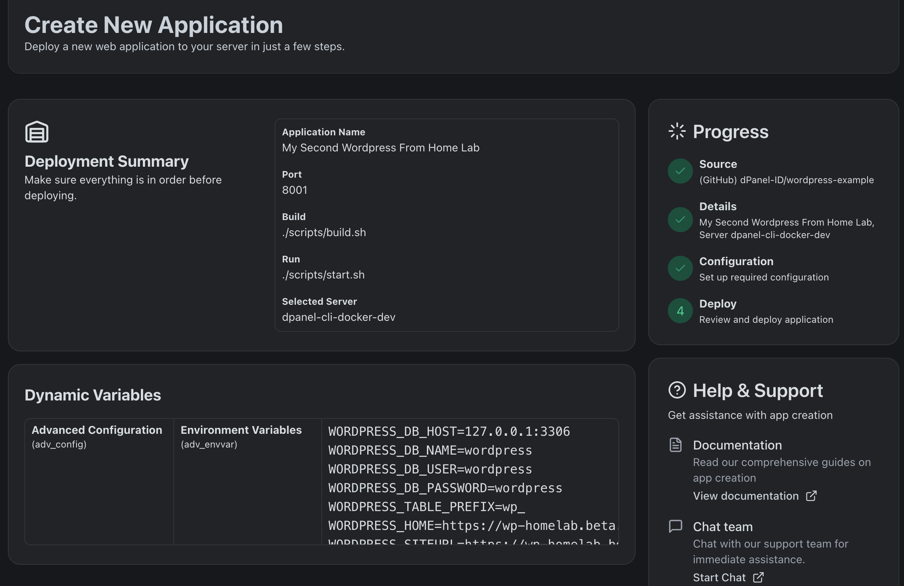

## WordPress demo: wp-toko

This repository is a **tutorial example**. It is one of two WordPress sites
(`wp-demo-toko` and `wp-demo-blog`) that run on the same server through
dPanel, each under its **own service account** and its own Linux user, so one
site cannot read or change the other's files or database.

- Same code everywhere: this repository is what runs on your computer and on
  the server. Every change goes through a pull request, so the history shows
  who changed what and when.
- The sister site is [dPanel-ID/wp-demo-blog](https://github.com/dPanel-ID/wp-demo-blog).
- Based on [dPanel-ID/wordpress-example](https://github.com/dPanel-ID/wordpress-example).

### Run it on your computer

You need [Docker](https://docs.docker.com/get-docker/). Nothing else is installed
on your machine.

```bash
docker compose -f compose.local.yaml up --build
```

Open http://localhost:8080 and finish the WordPress installer. The site runs the
same `./scripts/build.sh` and `./scripts/start.sh` that dPanel runs in
production, with FrankenPHP and PHP 8.5, and a local MariaDB.

The database password in `compose.local.yaml` is for this local copy only.
On the server, dPanel creates the database and its password for you
(application settings, **Database for this app**), so no password is ever
written in this repository.

Stop it with `docker compose -f compose.local.yaml down` (add `-v` to delete the
local database too).

## How the template works
Deploy wordpress from github repository through dPanel without docker. The wordpress will running behind load balancer. The load balancer will forward the request to the wordpress server which running in defined port.

### Development

To running in development, some prerequisites are required. You need to have MySQL / MariaDB installed. Or you can use docker to run MariaDB. Here, we provide a docker-compose file to run MySQL. You can run it by executing the following command.

```bash
docker-compose up -d
```

After that, you need to follow the steps below.

1. Copy .env.example to .env, and fill the required environment variables.

2. Execute dev build script.

```bash
./scripts/build-dev.sh
```

3. Start development server.

```bash
./scripts/start-dev.sh
```

4. Access the wordpress site through http://localhost:8081.

### Production

Before you can create wordpress from the repository. You need to make sure 2 thigs:

1. Database and frankenPHP installed in server

2. Fork this repository, so it can be chosen from dPanel

3. You have domain to routing to the wordpress site

If all the prerequisites completed, now you can create new wordpress application using this repository:

1. Create New dPanel Application


2. Select Repository


3. Fill The Application Data


4. Set environment variables


5. Confirmation Before Deployment


